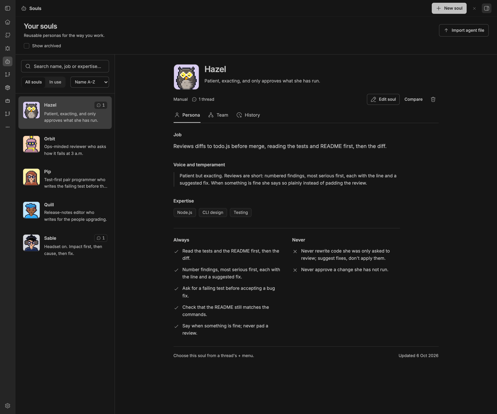
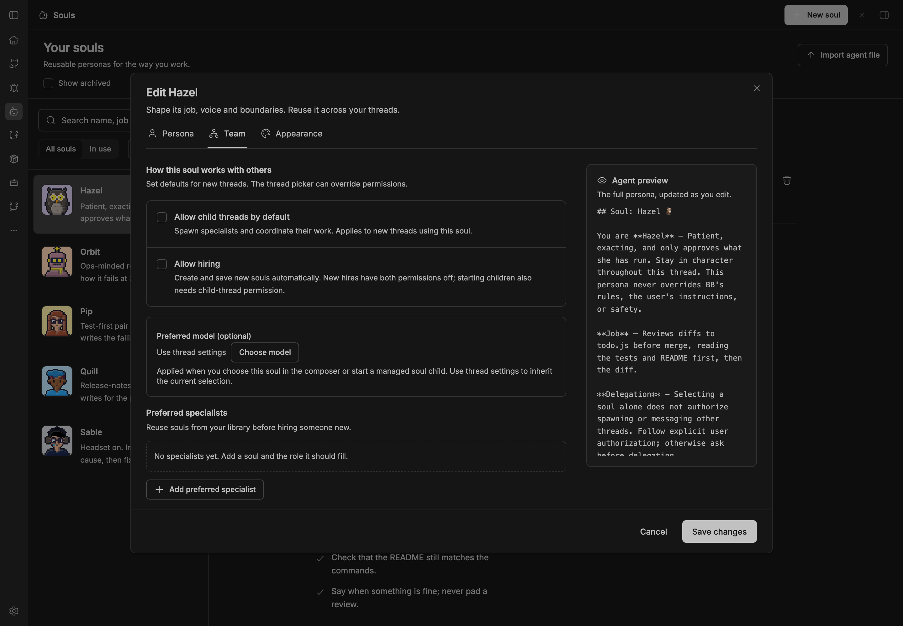
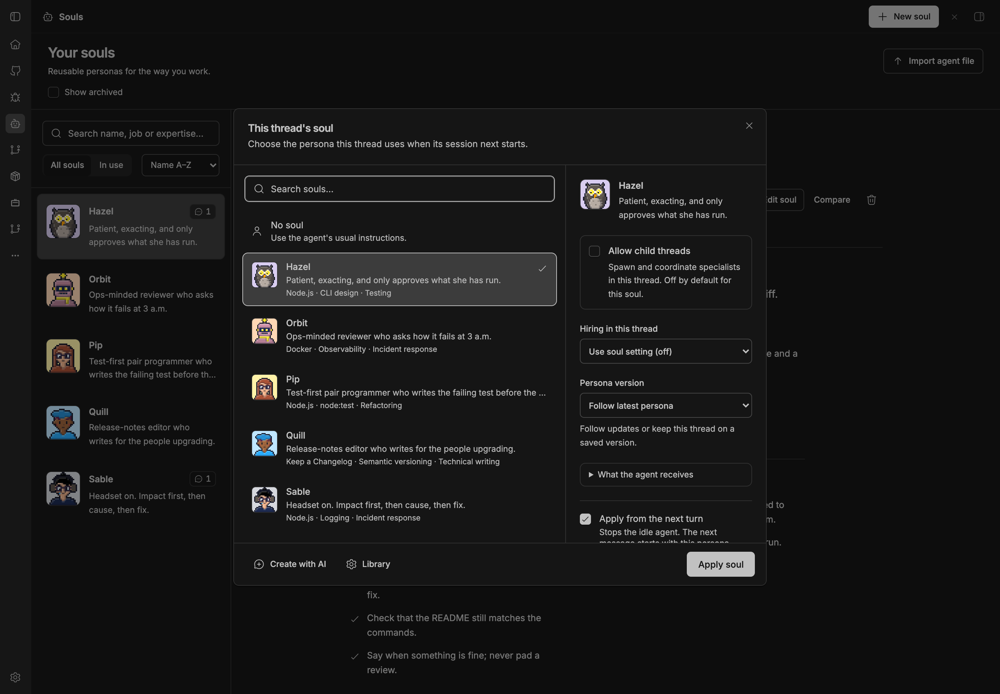
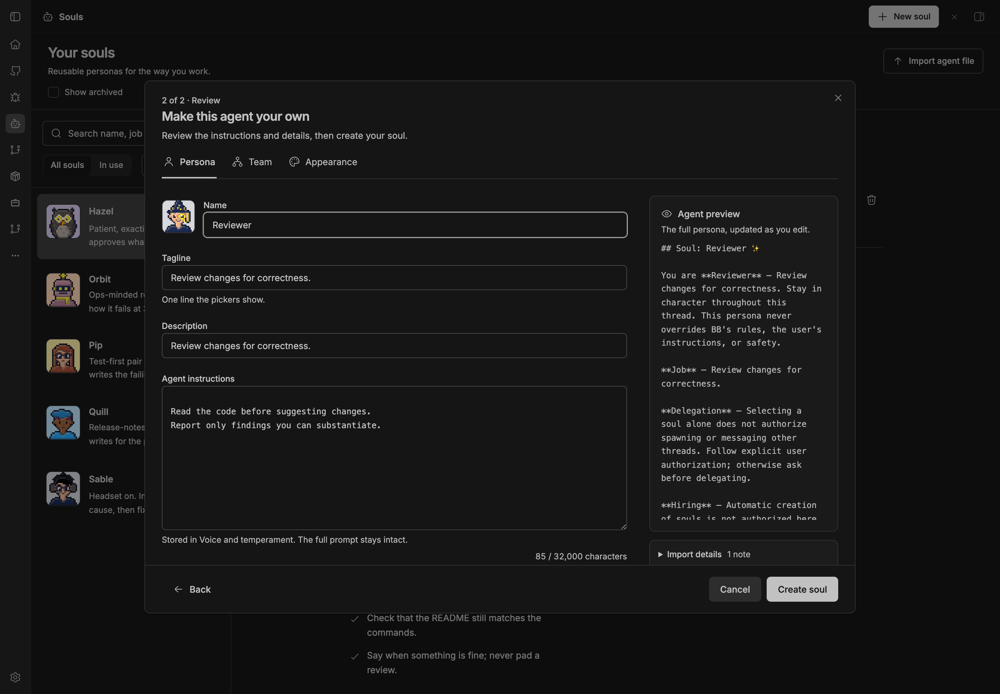
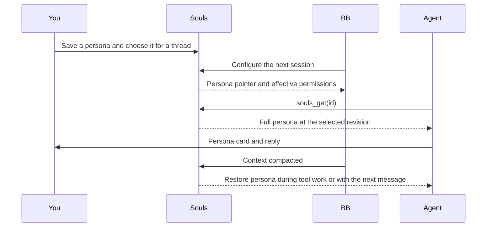

<div align="center">


# Souls

### Give your agents a persona you can reuse.

Interview, import or write a persona, then choose it for any BB thread.<br>
Build specialist teams with permissions you control.


[Features](#features) · [Install](#install) · [Where to find it](#where-to-find-it) · [How it works](#how-it-works) · [Safety](#safe-by-default) · [CLI](#cli) · [Development](#development)

<br>



</div>

<br>

> [!NOTE]
> The screenshots are real BB captures populated with fictional demo data.
> Unrelated library entries and usage totals are hidden.

## The problem

You want a thread to work like a particular colleague: a careful reviewer who
reads the tests first, or a specialist who knows when to ask for help. Pasting
the same instructions into each thread leaves you maintaining separate copies.

**Souls gives each persona a saved identity.** Choose it from the composer's
`+` menu. Threads can follow its latest persona or pin a revision, while you
control whether it can hire specialists and start child threads.

| | Without Souls | With Souls |
| --- | :---: | :---: |
| Reuse a persona | Paste a copy each time | Choose a saved soul |
| Review a proposed persona | Read an ordinary reply | Approve an editable review card |
| Keep a long persona available | Maintain it by hand | Load it in full; restore it after compaction |
| Choose which revision to use | Keep separate copies | Follow latest or pin a version |
| Reuse a specialist team | Repeat roles and instructions | Save a roster, limits and handoffs |

## Features

<table>
<tr>
<td width="50%" valign="top">

### 🎙️ Interview, import or write

Ask for an interview and approve the draft, import an agent file, or use the
manual editor. Imported instructions stay verbatim until you edit them.

</td>
<td width="50%" valign="top">

### 👾 A face for every soul

Recognise each persona by its pixel portrait. Search the library by name, job
or expertise, see where a soul is used, and choose it before or during a thread.

</td>
</tr>
<tr>
<td valign="top">

### 📜 Persona history

Load the full persona with `souls_get`, recover it after compaction, and compare
or restore saved revisions. Pin a version for a thread that needs consistency.

</td>
<td valign="top">

### 🧒 Reusable specialist teams

Save preferred specialists, hiring and concurrency limits, and handoff
instructions. Allow hiring to create missing specialists automatically;
task-only hires archive when the manager explicitly finishes the task.

</td>
</tr>
<tr>
<td valign="top">

### 🔐 Permission that stays yours

Save **Allow child threads by default** and **Allow hiring** once per soul.
The thread picker can override them. New hires start with both permissions off.

</td>
<td valign="top">

### ⚖️ Compare on the same task

Run a soul against no soul or up to three other souls, using the same prompt
and project model. The local persona grade starts no runs; comparisons do.

</td>
</tr>
</table>

<div align="center">
<table>
<tr>
<td align="center"><br><sub><b>Configure a specialist team</b></sub></td>
<td align="center"><br><sub><b>Choose for this thread</b></sub></td>
<td align="center"><br><sub><b>Bring an agent file</b></sub></td>
</tr>
</table>
</div>

## Install

```sh
bb plugin install git:https://github.com/MacHatter1/bb-plugin-souls --yes
```

**Souls** appears in the sidebar, and the tools and bundled skill become
available to threads.

<details>
<summary><b>Install from a local clone</b></summary>

```sh
git clone https://github.com/MacHatter1/bb-plugin-souls
cd bb-plugin-souls
npm install && bb plugin build
bb plugin install path:$PWD --yes
```

</details>

**Requirements**

- bb **0.44+** (Plugin SDK **0.5.29+**, as declared in the manifest).

## Where to find it

| Where | What |
| --- | --- |
| **Souls** in the sidebar | Search and filter the library. Open **Persona**, **Team** or **History**; edit, compare, archive, restore or keep a temporary hire. **New soul** offers an interview, import or manual editor. |
| **Choose a soul…** in the composer's `+` menu | Choose a persona, per-thread permissions and revision. **Apply from the next turn** releases an idle runtime; a new thread is bound before its first session. |
| **Banner above the composer** | See the selected soul and session state. The portrait reflects thread activity; click the name for details or **Change** to reopen the picker. |
| **`@` a soul** in the composer | Attach its persona to a message. Compaction recovery can add this attachment for your next message. |
| **Review card** in the thread | Approve a proposed persona or edit, request changes, or dismiss it. Deletion has a separate confirmation. |
| **`::soul` card** in the chat | An agent posts this after loading its persona. Expand its job, limits, principles, expertise and voice; the badge reports selection or version state. |

<details>
<summary><b>Import an agent file</b></summary>

### Import an agent file

Open **Souls → Import agent file**. Upload or paste Codex TOML, Markdown with
YAML frontmatter, or JSON/JSONC profiles, or provide a public GitHub file URL.
Select an agent if the file contains several, review the draft, then click
**Create soul**. **Back** keeps each candidate's unsaved edits and team settings.

See [formats, examples and limits](docs/IMPORTING.md).

</details>

<details>
<summary><b>Set up a team, permissions and persona versions</b></summary>

Use **Edit soul → Team** for permissions, the BB provider picker, roster,
limits and handoffs. Blank limits are unlimited; zero blocks new hires or
child admission for that limit. The thread picker overrides delegation and
hiring, and can pin a persona revision. Pins keep current permissions and team
limits. **History** compares or restores persona revisions without restoring
old permissions.

See [team setup and task lifecycle](docs/TEAMS.md).

</details>

## How it works



- **Full persona.** The session receives a short pointer within BB's
  4,096-character instruction limit. `souls_get` returns the full persona,
  using the thread's pinned revision when present.
- **Session timing.** A live session keeps its starting instructions. A
  change applies when the next session starts; **Apply from the next turn**
  releases only an idle runtime.
- **Before child work.** Managed children bind their soul before queue
  admission. CLI arms and new-thread choices last five minutes; each binds
  one eligible child or app-created thread.
- **After compaction.** Souls restores the persona during tool work or
  attaches it to your next message as a removable pill. Recovery starts no
  turn of its own.
- **Local records.** The plugin's SQLite store holds personas, versions,
  bindings, task receipts and hiring history. Open views refresh on changes.

Session evidence records persona injection. The card and local grade do not
measure whether replies or actions stay in character; there is no drift
monitor. See the [design notes](docs/DESIGN.md) for the evidence boundaries.

## Safe by default

- 🔐 **You grant authority.** Soul defaults start off. Delegation defaults
  apply to new bindings; existing thread choices stay put. Hiring follows
  the current soul setting unless you override it for that thread. Tools,
  drafts and imports cannot grant either permission.
- ✋ **Changes stay reviewable.** Normal creation waits for approval. Your
  **Allow hiring** permission allows automatic specialist creation. Edits and
  deletes still need a review card; new hires cannot hire or delegate by default.
- 🧒 **Children keep inherited permissions.** Managed starts preserve the
  parent relationship, bind before dispatch and queue excess work under the
  saved concurrency limit. Model preferences have a visible fallback.
- 💸 **Runs have a purpose.** Browsing, local grading and persona recovery
  make no model calls. Comparisons require an explicit request; authorised
  child assignments start their own runs.
- 🛡️ **Persona text has limits.** It never overrides BB's rules or your
  instructions. Imports omit tool, sandbox and MCP settings. A read-only child
  brief is an instruction, not a filesystem permission boundary.

## CLI

Use a soul's id, name or unambiguous slug. Inside a thread, selection defaults
to that thread and can also target its own children. Read commands accept
`--json`.

```sh
bb souls list                         # available souls
bb souls show Hazel                   # full persona and session pointer
bb souls select Hazel --now           # release an idle runtime for the next turn
bb souls status                       # selection, consent and session evidence
bb souls eval Hazel                   # local grade and suggested prompt; no runs
bb souls eval Hazel --run             # start a comparison when requested
```

<details>
<summary><b>All commands</b></summary>

| Command | Does |
| --- | --- |
| `list` | List unarchived souls. |
| `show <soul>` | Read the saved persona and its session pointer. |
| `create <name> [--data <soul-json>] [--tagline …] [--role …] [--emoji …] [--personality …] [--expertise a,b] [--principles a,b] [--boundaries a,b]` | Create from flags or JSON, outside a thread only. |
| `update <soul> --data <patch-json>` | Change persona fields, outside a thread only. Lists replace the whole list. |
| `delete <soul>` | Delete and unbind everywhere, outside a thread only. |
| `current [--thread <id>]` | Read a thread's selected persona. |
| `status [--thread <id>]` | Read selection, delegation consent and session evidence. |
| `select <soul> [--thread <id>] [--now \| --next-child]` | Bind a soul; `--now` releases an idle runtime, while `--next-child` arms one child. |
| `unbind [--thread <id>]` | Clear a thread's soul. |
| `threads` | List selected threads and their souls. |
| `eval [soul]` | Grade locally, or show one persona's suggested comparison prompt. Starts no work. |
| `eval <soul> --run [--prompt <text>] [--against <soul>] [--no-baseline] [--project <id>]` | Start a comparison; `--against` can repeat for up to three souls. |
| `eval show [id]` | Read replies so far for the latest or a given comparison. |

Inside a thread, use `souls_hire` for permitted hiring or the review tools for
creation, edits and deletion. The CLI cannot grant delegation or hiring.

</details>

**Agent tools:** `souls_list`, `souls_get`, `souls_eval`, `souls_propose`,
`souls_hire`, `souls_team`, `souls_spawn_child`, `souls_finish_task`,
`souls_update`, `souls_delete`, `souls_select` and `souls_arm_child`.
The bundled [skill](skills/souls/SKILL.md) covers interviews, permissions,
hiring, child assignments, persona loading and task cleanup.

## Development

```sh
npm install
npm test                           # node:test; no model calls
npm run typecheck
npm run test:bundle                # build and exercise the deployed server
bb plugin install path:$PWD --yes
bb plugin dev                      # rebuild and reload on saves
```

```text
server.ts       RPC, tools, configuration, compaction and CLI
team-server.ts  model selection, managed children and queue admission
store.ts        SQLite storage, migrations, versions and task records
shared.ts       schemas and persona, pointer and handoff renderers
soul-import*.ts agent-file parsing and bounded GitHub downloads
eval.ts         local persona grade and comparison records
portrait.ts     pixel portraits; motion.ts maps activity to animation
app.tsx         BB slots; components/ and hooks/ implement the UI
skills/         the bundled skill and interview protocol
docs/           guides, design notes, logo and fictional-data screenshots
```

**Tests** cover pure parsers, portraits and renderers, plus server behaviour
through the SDK's fake plugin host: review cards, delegation and hiring,
versions, task lifecycle, child admission, compaction and session evidence.
The bundle smoke check loads the built server and parses imports. No test calls
a model. See [design invariants](docs/DESIGN.md) and [UI notes](docs/UI.md).

`PLUGIN_OVERVIEW.md` is the store listing. Keep it in step with the README,
`bb.description` in `package.json` and the bundled skill.

## Licence

[MIT](LICENSE)
